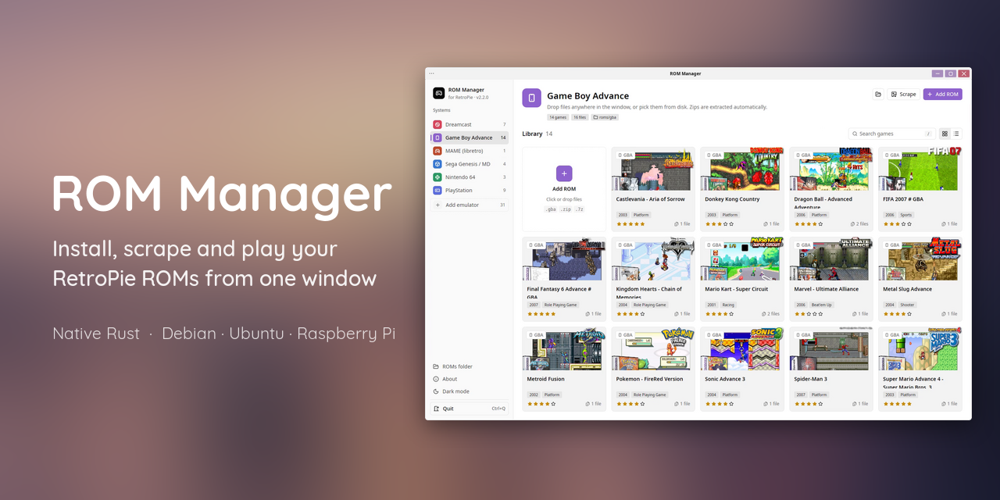
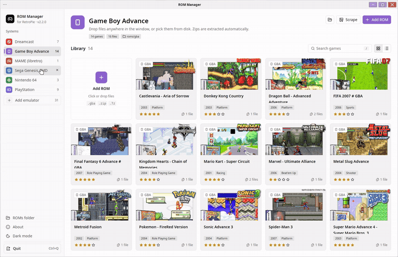
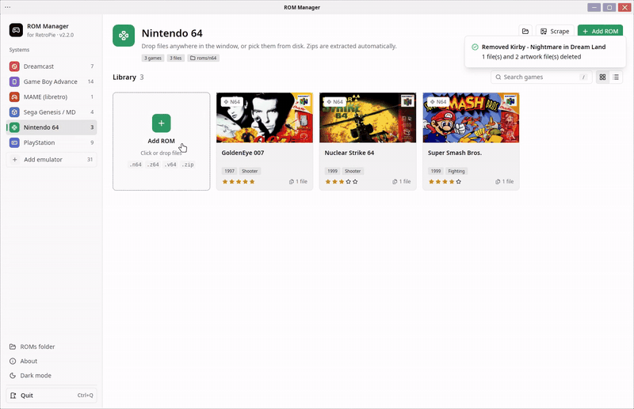
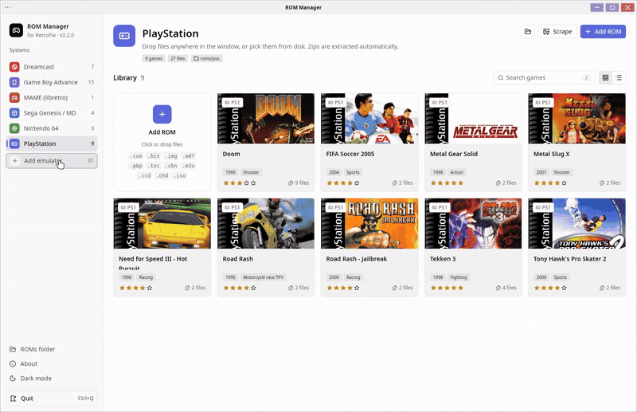
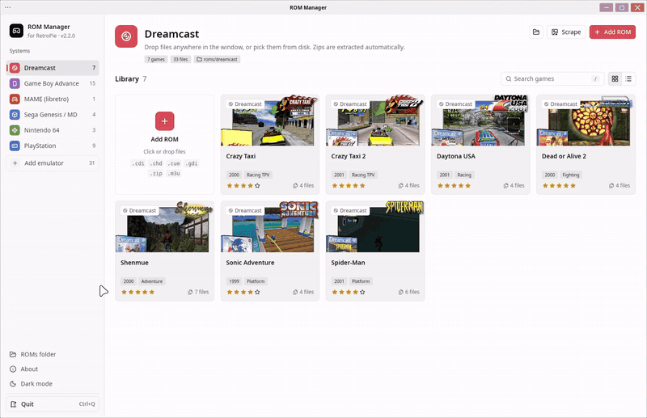
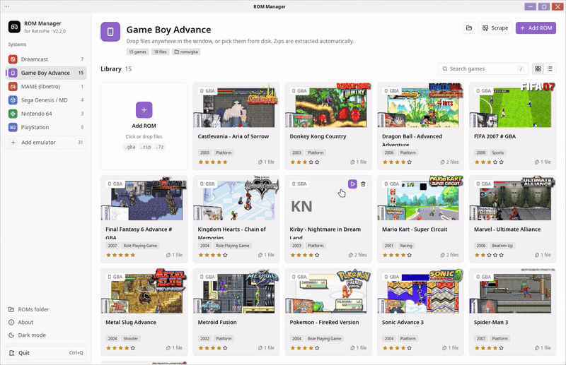
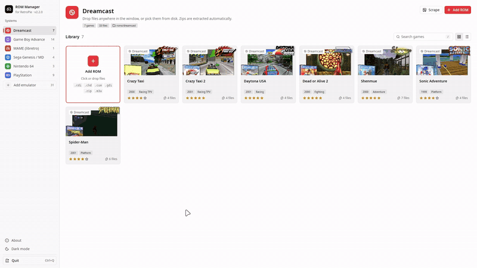

<p align="center">
  
</p>

<p align="center">
  <a href="https://github.com/fa-saikat/retropie-rom-manager/releases/latest"></a>
  <a href="https://github.com/fa-saikat/retropie-rom-manager/actions/workflows/ci.yml"></a>
  
  
  <a href="LICENSE"></a>
</p>

<p align="center">
  <a href="#features">Features</a> ·
  <a href="#installing">Install</a> ·
  <a href="#keyboard">Keyboard</a> ·
  <a href="#how-it-works">How it works</a> ·
  <a href="#limitations">Limitations</a> ·
  <a href="#building">Build</a> ·
  <a href="#about-the-code">About the code</a>
</p>

> [!NOTE]
> ROM Manager is young. It works, but expect rough edges, and please
> [report them](https://github.com/fa-saikat/retropie-rom-manager/issues/new/choose).

> [!WARNING]
> **This project is AI-assisted.** The majority of the code was written by AI,
> directed and tested by the author. See [About the code](#about-the-code).

## Why this exists

Managing ROMs on RetroPie usually means copying files into the right folder by
hand, remembering which extensions each emulator takes, running the scraper
from a text menu, and deleting a PlayStation game one `.bin` at a time.

ROM Manager does all of that from one window. Drop in a download and it lands
in the right folder, gets box art from Skyscraper, and shows up in a library
you can browse, play from and clean up. It uses RetroPie's own folders,
emulators and scraper, so nothing it does conflicts with EmulationStation, and
you never have to open a file manager or SSH into `~/RetroPie/roms`.

## Features

<table>
  <tr>
    <td width="50%" valign="top">
      
      <p><b>Install from your downloads.</b> Drag files onto the window, or pick them in the built-in file browser, which also lists USB drives and mounts them. Zips are extracted, and box art is fetched straight after.</p>
    </td>
    <td width="50%" valign="top">
      
      <p><b>Catches ROMs in the wrong system.</b> Files are identified by their headers, not their extension. Drop a GBA zip on N64 and it offers to install it to GBA instead.</p>
    </td>
  </tr>
  <tr>
    <td valign="top">
      
      <p><b>All 37 RetroPie systems.</b> The sidebar starts with six. Add emulator has the rest, with photos, search, and whether RetroPie has an emulator for each.</p>
    </td>
    <td valign="top">
      
      <p><b>Play without EmulationStation.</b> Play starts the game with RetroPie's default emulator for the system, with the same config files and saves.</p>
    </td>
  </tr>
  <tr>
    <td valign="top">
      
      <p><b>One entry per game.</b> A Dreamcast <code>.gdi</code> with six tracks, or a PlayStation <code>.cue</code> with its <code>.bin</code>s, is one card. Delete removes all of it, plus the artwork, and lists every file first.</p>
    </td>
    <td valign="top">
      
      <p><b>Works without a mouse.</b> In fullscreen on a TV, the arrow keys, Enter and Backspace reach everything, so a gamepad mapped to those keys drives the whole app.</p>
    </td>
  </tr>
</table>

Also:

- **Box art and metadata from [Skyscraper](https://github.com/Gemba/skyscraper)**,
  the scraper RetroPie ships, using your existing `skyscraper.cfg`.
  EmulationStation shows the art straight away. If Skyscraper is missing, the
  app offers to install it through RetroPie-Setup. You don't need any API keys.
- **A details panel for every game**: description, developer, publisher,
  genre, rating, which media types were saved, and every file on disk with its
  size.
- **Grid and list views**, search (press `/`), and light and dark themes.
- **Games already in the wrong folder** get a warning and a one-click move. If
  the right system isn't in your list yet, the app adds it.
- **Scales up on 1440p and 4K screens**, so it looks the same as at 1080p.
- **Quit asks first**, and says if anything is still in progress.

## Requirements

- A Linux desktop (X11 or Wayland) on x86_64 or arm64, with glibc 2.35 or
  newer. Debian 12, Ubuntu 22.04, Raspberry Pi OS Bookworm (64-bit) and current
  Armbian releases all qualify.
- A GPU driver with Vulkan or OpenGL ES 3. Any desktop PC has one, and so do
  the Raspberry Pi 4 and 5 and most Mali-based Armbian boards with a recent
  Mesa.
- RetroPie installed on the same machine through
  [RetroPie-Setup](https://retropie.org.uk/docs/Debian/), with ROMs in
  `~/RetroPie/roms`.

Installing, browsing and deleting ROMs works without RetroPie. Play needs
RetroPie's emulators. Artwork needs Skyscraper, which the app can install for
you. For stubborn archives, install `unzip` and `p7zip-full` and the app falls
back to them.

The RetroPie SD-card images aren't supported: they boot straight into
EmulationStation with no desktop, and most are 32-bit.

## Installing

Download the `.deb` for your architecture from the
[latest release](https://github.com/fa-saikat/retropie-rom-manager/releases/latest),
then install it:

| Machine                          | File           | Install with                                         |
|----------------------------------|----------------|------------------------------------------------------|
| PC                               | `*_amd64.deb`  | `sudo apt install ./retropie-rom-manager_*_amd64.deb` |
| Raspberry Pi 4/5, Armbian boards | `*_arm64.deb`  | `sudo apt install ./retropie-rom-manager_*_arm64.deb` |

Each release also has a `SHA256SUMS` file to check the downloads with
`sha256sum -c --ignore-missing SHA256SUMS`. CI install-tests both packages on
Debian 12 and 13 and Ubuntu 22.04 and 24.04.

Then launch **ROM Manager** from your app menu, or run `retropie-rom-manager`.
Right-click the launcher for **Open in Fullscreen**.

The arm64 build is new. If it doesn't start on your board, please
[open an issue](https://github.com/fa-saikat/retropie-rom-manager/issues) with
the board, OS and the terminal output.

### Command-line options

| Option                | Effect |
|-----------------------|--------|
| `--fullscreen`        | Run in fullscreen, e.g. on a TV. Fullscreen comes only from this option, so there's no key to switch it on or off. |
| `--theme light\|dark` | Start in the light or dark theme |
| `-h`, `--help`        | Print the options and exit |
| `-V`, `--version`     | Print the version and exit |

To make the UI bigger or smaller than it picks for your screen, set the scale
yourself, e.g. `ROM_MANAGER_SCALE=1.5 retropie-rom-manager`.

## Keyboard

Everything works without a mouse, from the arrow keys, Enter and Backspace
alone, so a gamepad mapped to those keys (with AntiMicroX, say) drives the
whole app. A ring shows where you are once you press a key; in fullscreen it
shows from the start.

| Key        | Effect |
|------------|--------|
| Arrow keys | Move between systems, the header buttons and the games. Moving onto a system opens it. |
| Enter      | Open the game's details, or press the button or item that has the ring |
| Backspace  | Go back: from the games to the sidebar, out of a sheet or dialog, up a folder in the file browser |
| P / S / X  | Play, scrape or delete the game that has the ring, without opening its details. X on a system in the sidebar removes it. Deleting always asks first. |
| `/`        | Search the library. Down or Enter goes to the first match, and Esc clears the search. |
| Ctrl+Q     | Quit |

In dialogs, the arrow keys move between the buttons and Enter presses the one
with the ring. Confirmations open on **Cancel**, so a stray Enter never deletes
anything.

## How it works

### Recognising the system

Each check is a fixed signature, not a guess:

- **Cartridges:** the N64 byte-order marker, the Nintendo logo in Game Boy and
  GBA headers, iNES and FDS headers, the SNES internal header (checksum pair,
  map mode, printable title), the `SEGA` header for Genesis and 32X,
  `TMR SEGA` with its region code to tell Master System from Game Gear, and the
  Lynx, Atari 7800, Neo Geo Pocket and Vectrex headers.
- **Discs:** the ISO9660 volume ID for PlayStation (a DVD-sized volume means
  PS2) and PSP, the Sega IP.BIN header for Dreamcast and Sega CD, GameCube and
  Wii disc magic (including WBFS, RVZ, WIA and GCZ containers), and GD-ROM
  metadata inside a CHD.

The app follows `.cue`, `.gdi` and `.m3u` files to their tracks and looks
inside single-file zips. A file it can't identify is left alone, so it only
warns when it's sure. Results are cached by size and modification time, so a
background scan of a large library only reads files that changed.

When a cartridge dump has a generic name, like an N64 game saved as `.bin`, the
app installs it with the extension the target emulator expects.

### Grouping multi-file games

Files with an anchor extension (`.m3u`, `.gdi`, `.cue` and similar) name a
game. Every other file joins the anchor with the longest matching name that
ends at a word boundary, so `Doom (Track 2).bin` joins `Doom.cue`, but
`Doomsday.bin` doesn't. Deleting a game removes the exact file list captured
when the library was read, so a half-finished copy elsewhere can't take another
game's files with it.

### Scraping

The app runs Skyscraper the same way RetroPie-Setup's menu does. First it
gathers data and media for the new ROMs into Skyscraper's cache. Then it
generates `gamelist.xml` and the images for EmulationStation. Multi-track games
are scraped once, through their `.cue`, `.gdi` or `.m3u`.

EmulationStation overwrites `gamelist.xml` when it quits. While it's running,
the app only fills the cache and tells you to quit EmulationStation and scrape
again.

Installing Skyscraper runs `retropie_packages.sh skyscraper _auto_` from
`~/RetroPie-Setup` and streams its output into the window. It only starts when
you click it. It uses `sudo` when that works without a password (the RetroPie
default) and otherwise `pkexec`. Either way it installs for your user, not
root.

### Supported systems

Amstrad CPC, Arcade (MAME), Atari 2600, Atari 5200, Atari 7800, Atari 800,
Atari Lynx, ColecoVision, Dreamcast, Fairchild Channel F, Famicom Disk System,
FinalBurn Alpha, Game Boy, Game Boy Color, Game Boy Advance, GameCube,
MAME (libretro), MSX, Neo Geo, Neo Geo Pocket, Neo Geo Pocket Color, NES,
Nintendo 64, PC Engine / TurboGrafx-16, PlayStation, PlayStation 2,
PlayStation Portable, Sega 32X, Sega CD, Sega Game Gear,
Sega Genesis / Mega Drive, Sega Master System, Sega SG-1000, Super Nintendo,
Vectrex, Wii and ZX Spectrum.

Accepted extensions for each one come from RetroPie's `platforms.cfg` and its
docs ([`src/systems.rs`](src/systems.rs)).

## Limitations

- **No 32-bit ARM (`armhf`) build.**
- **The ROM folder is fixed** at `~/RetroPie/roms`.
- **Play always uses the system's default emulator.** Per-game choices made in
  runcommand's menu are ignored, and emulators whose command needs runcommand's
  video-mode tokens (`%XRES%` and similar) won't start from the app.
- **`.7z` archives aren't inspected** for the wrong-system check.
- **A PlayStation `.chd` can't be told apart from a CD-format Dreamcast one**,
  so those are never flagged.
- **Discs of a multi-disc game only group into one entry** when an `.m3u` ties
  them together, which is also how RetroPie treats them.
- **Many of the newer systems share generic sidebar icons.**

If one of these matters to you,
[open a feature request](https://github.com/fa-saikat/retropie-rom-manager/issues/new/choose)
so we know what to do first.

## Building

You'll need a recent stable Rust toolchain, a Vulkan or OpenGL ES 3 driver, and
the development headers GPUI links against. On Debian or Ubuntu:

```sh
sudo apt install libxkbcommon-dev libxkbcommon-x11-dev libwayland-dev \
  libx11-xcb-dev libxcb1-dev libfontconfig-dev libfreetype-dev libvulkan-dev libzstd-dev
```

Build and run:

```sh
cargo build --release
./target/release/retropie-rom-manager
```

USB drives are listed with `lsblk` and mounted through `udisksctl` (the
`udisks2` package). The browser's **Use system picker** button goes through the
XDG desktop portal (`xdg-desktop-portal` plus a backend such as
`xdg-desktop-portal-gtk`), on both X11 and Wayland.

To build the Debian package yourself, install
[`cargo-deb`](https://github.com/kornelski/cargo-deb) and run `cargo deb`. The
package lands in `target/debian/`. Release packages are built and tested by CI.

<details>
<summary>Debug-build environment variables</summary>

Debug builds can open straight into a given state, which helps with
screenshots and testing without clicking around. Release builds ignore all of
these.

| Variable | Effect |
|---|---|
| `ROM_MANAGER_SYSTEM=<id>` | Open on a system, e.g. `psx` |
| `ROM_MANAGER_VIEW=list` | Start in list view |
| `ROM_MANAGER_OPEN=<index>` | Open the details panel for that card |
| `ROM_MANAGER_DIALOG=…` | `delete`, `about`, `quit`, `add-rom`, `add-rom-full`, `install-skyscraper`, `add-system`, `remove-system` or `move` |
| `ROM_MANAGER_RUN=…` | Start `install-skyscraper` or `scrape` right away |
| `ROM_MANAGER_INSTALL=<file>` | Act as if the file was dropped on the window |
| `ROM_MANAGER_CONFIGS=<dir>` | Read emulator configs from a stand-in for `/opt/retropie/configs` |
| `ROM_MANAGER_SETUP_NO_ELEVATE=1` | Run the Skyscraper installer without `sudo` or `pkexec` |

</details>

## About the code

ROM Manager is AI-assisted. The majority of the code was written by AI, and
directed, reviewed and tested by the author. The author decided what it does
and how it should look, tested each change before merging it, and sent back
what didn't work. Every change goes through its own issue and
pull request, so the history shows how it was built.

How it is checked today:

- `cargo test` covers detection, grouping, scraping and launching, which have
  no UI dependency.
- CI lints and tests every pull request, and for each release builds the amd64
  and arm64 packages and install-tests them on Debian 12 and 13 and Ubuntu
  22.04 and 24.04.
- The UI has no automated tests. It's checked by hand before each merge.

If you find something wrong in the code, please say so in an issue. It gets
the same attention as any other bug.

## Contributing

Bug reports and pull requests are welcome. If a ROM is detected as the wrong
system, or isn't detected when it should be, use the
[wrong system form](https://github.com/fa-saikat/retropie-rom-manager/issues/new?template=wrong_system.yml).
It asks for the file name and size, so don't attach the ROM itself.

[CONTRIBUTING.md](CONTRIBUTING.md) covers the development setup, pull requests
and how versions are numbered.

## Credits

Developed by Fahim A Saikat and Ukay K Marma.

ROM Manager builds on:

- **[GPUI Kit](https://gpui-kit.com)** on top of **[GPUI](https://www.gpui.rs)**,
  the framework behind the Zed editor, for the UI.
- **[RetroPie](https://retropie.org.uk)**: its folders, emulator configs and
  RetroPie-Setup.
- **[Skyscraper](https://github.com/Gemba/skyscraper)** and the databases it
  uses, for artwork and metadata.
- Icons from [Tabler](https://tabler.io/icons) and [Lucide](https://lucide.dev),
  and system photos from Wikimedia Commons, credited in
  [`assets/systems/CREDITS.md`](assets/systems/CREDITS.md).

This project isn't affiliated with RetroPie. If it saves you some time, a star
helps other people find it.

## License

ROM Manager is released under the [MIT License](LICENSE). © 2026 JaduPc.
